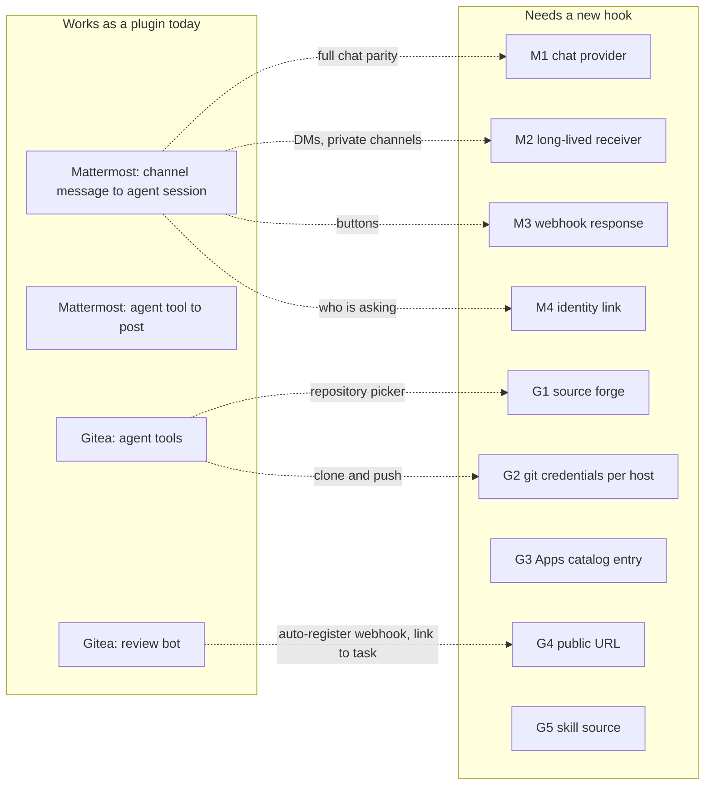
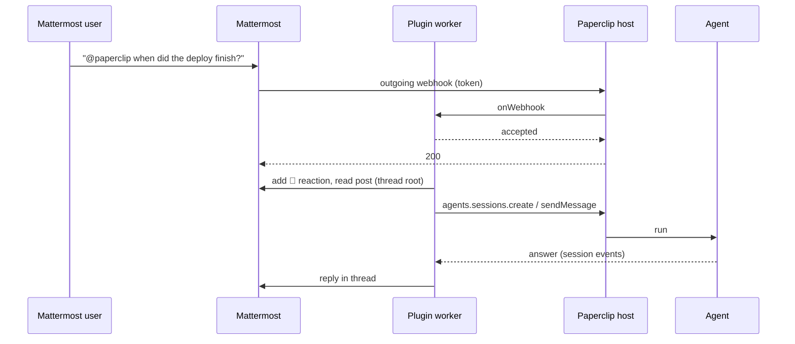
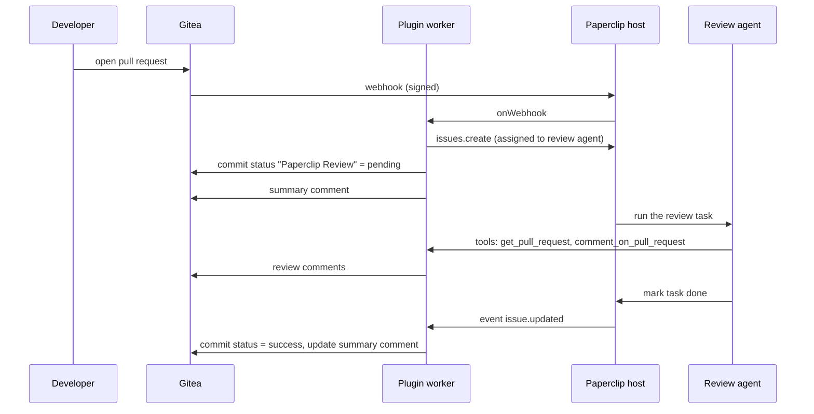

# Community plugins for Gitea and Mattermost: what works today and which hooks are missing

Date: 2026-11-13. Checked against `master` at `e6df84a99`.

## Why this document

I run Paperclip from source on a self-hosted setup with Gitea and Mattermost. I built both integrations as core changes first. The guidance is that community features should ship as plugins, so I rebuilt what I could as plugins. This document lists what the plugin surface could do, where it stopped, and the hooks I would need to finish the job.

The two plugins are on the branch `feat/community-plugins` of `Daenks/paperclip`, under `packages/plugins/plugin-mattermost` and `packages/plugins/plugin-gitea`. Both typecheck, pass the host's manifest schema, and have tests on the SDK test harness (8 each). Neither has been installed on a live instance yet.

## Summary

| Feature | As a plugin today | Blocked on |
| --- | --- | --- |
| Mattermost: talk to an agent from a channel | Works, with limits | Hooks M1 to M4 |
| Mattermost: agent posts to a channel | Works (agent tool) | Nothing |
| Gitea: agent tools for repositories and pull requests | Works | Nothing |
| Gitea: pull request review bot | Works, webhook added by hand | Hook G4 |
| Gitea: pick a Gitea repository for a project | Not possible | Hook G1 |
| Gitea: git access to private repositories | Not possible | Hook G2 |
| Gitea: connection in the Apps catalog | Not possible | Hook G3 |
| Gitea: import skills from a Gitea repository | Not possible | Hook G5 |
| Side pane default, agents page default view | Not possible | See "Not plugin work" |

## Mattermost

### What the plugin does

Capabilities used: `webhooks.receive`, `http.outbound`, `secrets.read-ref`, `agent.sessions.create`, `agent.sessions.send`, `agent.tools.register`, `plugin.state.read`, `plugin.state.write`, `agents.read`.

### What the core chat providers do that the plugin cannot

The Slack and Discord providers live in the core chat-channel subsystem. A plugin has no entry into it, so the plugin talks to an agent session instead. The differences:

| | Core chat provider | Plugin today |
| --- | --- | --- |
| Where it is set up | Apps > Chat, same screen as Slack and Discord | Plugin settings form |
| What a message becomes | A task bound to the conversation | A message in an agent session |
| Who is asking | Identity link from chat user to Paperclip user | Not known. All users are treated the same |
| Direct messages, private channels | Yes | No. Outgoing webhooks fire in public channels only |
| Needs a trigger word | No (mention or DM) | Yes |
| Approvals and questions as buttons | Yes | No |
| Edits, deletes, reactions from users | Yes | No |

### Hooks requested

**M1. Chat provider extension point.** Let a plugin register a chat provider: its credentials form, how to receive a message, how to send one, and what it supports (threads, reactions, buttons, files). The host keeps what it already owns: connections, the bound task, identity links, destinations, and run publications. This is the hook that gives a community chat integration the same behavior as Slack or Discord. Without it, each community chat plugin rebuilds a smaller version of the chat subsystem on agent sessions.

**M2. Long-lived receiver with a lease.** Mattermost delivers direct messages, private channels, edits and reactions only over the bot WebSocket. The core Discord provider holds its gateway connection under a receiver lease so that one instance owns it. A plugin worker has no lease, and `onIdleDrain` must report `none` only when sockets are settled, so a plugin that holds a socket blocks idle sleep for good. Request: a way for a plugin to declare a receiver that the host leases to one worker and counts correctly for idle sleep.

**M3. Webhook handlers that return a response.** `onWebhook` returns nothing, and the host answers every delivery with a fixed body. Mattermost interactive buttons and slash commands read the response body (for example to update the message that was clicked). Request: let `onWebhook` return a status, headers and a JSON body. This would also let a plugin answer a provider's URL verification challenge.

**M4. Identity links for plugins.** `issues.createComment` already accepts `actorUserId` for "a paired chat user", but a plugin has no API to create or look up that pairing. Request: a small identity API, scoped to the plugin, to link an external user ID to a Paperclip user (with the user's consent) and to resolve it later.

## Gitea

### What the plugin does

Capabilities used: `webhooks.receive`, `http.outbound`, `secrets.read-ref`, `issues.create`, `issues.read`, `issue.comments.create`, `events.subscribe`, `agent.tools.register`, `plugin.state.read`, `plugin.state.write`.

### What the core change does that the plugin cannot

My core change makes Gitea a second source forge next to GitHub: a company picks its default forge, a project is created from a Gitea repository, the server clones it, and the agent's `git` can push. None of that is reachable from a plugin.

### Hooks requested

**G1. Source forge extension point.** Let a plugin register a forge: list repositories for the repository picker, describe a repository (ID, URL, private or not, default branch), and appear as a choice for a company's default forge and a project's forge. Today the picker and those settings know only GitHub. Related request from the community: issue #1052.

**G2. Git credentials for other hosts.** `projects.resolveGitCredential` gives a plugin a short-lived credential, and only for GitHub. The need here runs the other way: when the server clones a project repository, or an agent runs `git` against a host, ask the plugin that owns that host for a credential. The credential must be scoped to that host and must not be written into the repository's git config. Without this, private Gitea repositories work only if the operator sets up git access outside Paperclip.

**G3. Apps catalog entry from a plugin.** The Apps catalog is where an operator connects a service and where MCP tool access is governed. A plugin cannot add an entry. Request: let a plugin contribute a connectable app (name, logo, connection methods and their fields), so a community integration is found in the same place as the built-in ones.

**G4. Public URL of the instance.** A plugin cannot learn the instance's public base URL. The Gitea plugin therefore cannot register its webhook in Gitea for the operator, and it cannot set the commit status link to the review task. Request: a read-only call that returns the public base URL, the plugin's webhook URL for an endpoint key, and the URL of an issue.

**G5. Skill source providers.** Skills can be imported from GitHub repositories. Request: let a plugin act as a source for a host, so a company can import skills from a Gitea repository, including a private one.

## Not plugin work

Two small UI changes of mine have no plugin route, and I do not think they should get one:

- **Default state of the task side pane.** A per-browser setting for whether the pane starts open and on which tab, and each task remembers its own state. One part is a fix: with the Coordinator workspace on, the pane closes on every route change.
- **Default view of the agents page.** A switch to open the agents page on the org chart.

Plugins can add pages, tabs and buttons. They cannot change how a core page behaves. I would propose these as small core changes, or drop them if they are not wanted.

My bug fixes (Windows shell and build, redacted secrets, routine dispatch deadlock, MCP discovery 404, chat-bound task release, inbox links) are fixes to core code and stay as ordinary pull requests.

## Questions for the team

1. Is a chat provider extension point (M1) something you would accept, or should community chat integrations stay on agent sessions?
2. For Gitea, is a source forge extension point (G1 with G2) the direction you want, or would you take first-class support for a second forge in core?
3. M3 and G4 are small and help every webhook-based plugin. Would you take pull requests for those two first?
4. Is there a preferred place for community plugins to live: separate repositories with npm packages, or `packages/plugins` in this repository?
